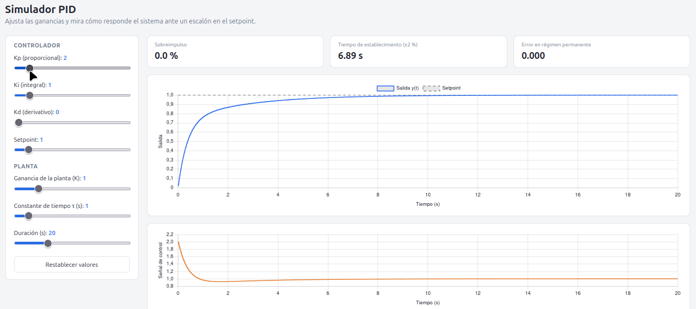

# Simulador PID en tiempo real

Aplicación web que simula un sistema de control PID sobre una planta [estanque de agua / control de temperatura]. Puedes ajustar Kp, Ki y Kd con sliders y ver en vivo cómo responde el sistema.



🔗 **Demo online:** [link cuando lo despliegues]

## ¿Qué hace?

- Simula la respuesta de una planta ante un setpoint configurable
- Permite ajustar Kp, Ki y Kd en tiempo real
- Grafica la salida, el setpoint y el error
- Calcula métricas: sobreimpulso, tiempo de establecimiento y error en régimen permanente

## Tecnologías

- **Backend:** Python, FastAPI, NumPy, SciPy
- **Frontend:** HTML, JavaScript, Chart.js
- **Calidad:** pytest, Ruff, GitHub Actions
- **Despliegue:** Docker

## Cómo correrlo en local

```bash
git clone https://github.com/[tu-usuario]/pid-simulator.git
cd pid-simulator
python3 -m venv .venv
source .venv/bin/activate
pip install -r requirements.txt
uvicorn app.main:app --reload
```

Abre http://localhost:8000

### Con Docker

```bash
docker build -t pid-simulator .
docker run -p 8000:8000 pid-simulator
```

## Tests

```bash
pytest
```

## Cómo funciona

El controlador implementa la ley de control PID discreta. El detalle del modelo de la planta y las ecuaciones está en [docs/ecuaciones.md](docs/ecuaciones.md).

## Posibles mejoras

- [ ] Sintonización automática (Ziegler-Nichols)
- [ ] Más tipos de planta
- [ ] Perturbaciones en la simulación
- [ ] Exportar resultados a CSV

## Autor

**Emmanuel Andaur** — Estudiante de Ingeniería en Informática, Universidad Católica Silva Henríquez

[LinkedIn](https://www.linkedin.com/in/emmanuel-andaur-9019042b6/) · [GitHub](https://github.com/ElPropo)
