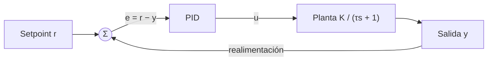

# Modelo y ecuaciones

Este documento explica qué se simula, con qué ecuaciones y cómo se calculan las métricas que muestra la interfaz.

## 1. Lazo de control

El sistema es un lazo cerrado con realimentación unitaria: el controlador PID compara el setpoint con la salida medida y calcula la señal de control que se aplica a la planta.

## 2. Controlador PID

En tiempo continuo:

$$u(t) = K_p\,e(t) + K_i \int_0^t e(\tau)\,d\tau + K_d \frac{de(t)}{dt}$$

En el simulador se usa la versión discreta con paso de tiempo $\Delta t$:

$$e_k = r - y_k$$

$$I_k = I_{k-1} + e_k\,\Delta t$$

$$D_k = \frac{e_k - e_{k-1}}{\Delta t}$$

$$u_k = K_p\,e_k + K_i\,I_k + K_d\,D_k$$

En el primer paso no existe un error previo, por lo que se toma $D_0 = 0$.

### Saturación y anti-windup

La señal de control se limita al rango $[u_{min},\, u_{max}]$ cuando se configura. Si la salida del controlador se satura, el término integral **no se actualiza** en ese paso (integración condicional). Así se evita el *windup*: que la integral siga creciendo mientras el actuador no puede responder, lo que provocaría un sobreimpulso grande al salir de la saturación.

## 3. Planta de primer orden

La planta se modela con una ecuación diferencial de primer orden, con ganancia estática $K$ y constante de tiempo $\tau$:

$$\tau\,\frac{dy}{dt} + y = K\,u \qquad\Longleftrightarrow\qquad G(s) = \frac{K}{\tau s + 1}$$

Se integra con el método de Euler explícito:

$$y_{k+1} = y_k + \frac{\Delta t}{\tau}\left(-y_k + K\,u_k\right)$$

El código exige $\tau \ge \Delta t$. Con eso el factor $1 - \Delta t/\tau$ queda entre 0 y 1, y la discretización no introduce oscilaciones que no existen en el sistema continuo.

## 4. Comportamiento en lazo cerrado

### Solo proporcional

$$T(s) = \frac{K K_p}{\tau s + 1 + K K_p} \qquad\Rightarrow\qquad y_{ss} = \frac{K K_p}{1 + K K_p}\,r$$

El error permanente es $e_{ss} = \dfrac{r}{1 + K K_p}$. Con $K = 1$ y $K_p = 1$ la salida se queda en $0{,}5\,r$, y el simulador lo muestra como un error de 0,5 y "No se estabiliza". Este caso está cubierto por un test.

### Proporcional + integral

Con $C(s) = K_p + K_i/s$:

$$T(s) = \frac{K\,(K_p s + K_i)}{\tau s^2 + (1 + K K_p)\,s + K K_i}$$

Por el teorema del valor final, $T(0) = 1$: el error en régimen permanente es cero. Esa es la razón de ser de la acción integral.

Ejemplo con los valores por defecto de la interfaz ($K = 1$, $\tau = 1$, $K_p = 2$, $K_i = 1$):

$$T(s) = \frac{2s + 1}{s^2 + 3s + 1}$$

Los polos están en $s = \dfrac{-3 \pm \sqrt{5}}{2} \approx -0{,}38$ y $-2{,}62$. Son reales y negativos, así que el sistema es estable y no oscila. La respuesta al escalón se acerca a $r$ sin sobrepasarlo, lo que coincide con lo que dan la simulación y sus tests.

## 5. Métricas

Todas se calculan sobre la respuesta a un escalón de setpoint $r > 0$, con la planta partiendo en reposo ($y(0) = 0$).

- **Sobreimpulso:** $M_p = \max\!\left(0,\ \dfrac{y_{max} - r}{r}\right) \times 100\,\%$
- **Tiempo de establecimiento (±2 %):** primer instante a partir del cual $|y(t) - r| \le 0{,}02\,r$ se cumple hasta el final de la simulación. Si la salida sigue fuera de la banda en la última muestra, se informa que no se estabiliza.
- **Error en régimen permanente:** $e_{ss} = r - y(T_{final})$, usando la última muestra de la simulación como aproximación del régimen permanente.

## 6. Supuestos y límites

- La entrada es un escalón de setpoint y la planta parte desde cero.
- La integración es Euler explícito: al aumentar $\Delta t$ baja la precisión.
- Con ganancias muy altas el esquema discreto puede divergir. En ese caso la API responde con un error 422 en vez de devolver datos inválidos.
- No hay ruido de medición ni perturbaciones.
- La derivada se calcula sobre el error y no está filtrada, por lo que en un sistema real sería sensible al ruido.

## 7. Referencias

- K. J. Åström y R. M. Murray, *Feedback Systems: An Introduction for Scientists and Engineers*.
- K. Ogata, *Ingeniería de control moderna*.
